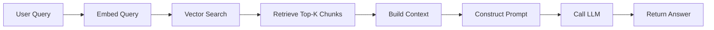

# Day 10: AI - RAG & Final Exam Review

**Date:** October 1, 2026 | **Exam Weight:** 25-30% (Implement AI Capabilities) + Full Review

---

## Learning Objectives

- [ ] RAG use cases and architecture
- [ ] `sp_invoke_external_rest_endpoint` for LLM calls
- [ ] Structured data to JSON for language model processing
- [ ] Prompt engineering, response extraction
- [ ] End-to-end RAG pipeline
- [ ] **Final comprehensive review of all 9 days**

---

## Core Concepts

### 1. Retrieval-Augmented Generation (RAG) Architecture



**RAG Pipeline Components:**
| Component | SQL Server Implementation |
|-----------|---------------------------|
| Query Embedding | `sp_invoke_external_model` with embedding model |
| Vector Search | `VECTOR_DISTANCE` + HNSW index / `VECTOR_SEARCH` |
| Context Assembly | `STRING_AGG` or JSON aggregation |
| Prompt Construction | T-SQL string concatenation / `JSON_MODIFY` |
| LLM Call | `sp_invoke_external_rest_endpoint` |
| Response Parsing | `JSON_VALUE`, `OPENJSON` |

---

### 2. Complete RAG Implementation

```sql
-- 1. Setup: Documents with embeddings (from Day 9)
-- Documents table with VECTOR(1536) Embedding column, HNSW index

-- 2. RAG Stored Procedure
CREATE OR ALTER PROCEDURE dbo.usp_RAG_Query
    @UserQuestion NVARCHAR(MAX),
    @TopK INT = 5,
    @DistanceThreshold FLOAT = 0.3,
    @Model NVARCHAR(100) = 'gpt-4o',
    @Answer NVARCHAR(MAX) OUTPUT,
    @Citations NVARCHAR(MAX) OUTPUT
AS
BEGIN
    SET NOCOUNT ON;

    -- Step 1: Embed user question
    DECLARE @queryVector VECTOR(1536);
    EXEC sp_invoke_external_model
        @model = 'text-embedding-3-small',
        @input = @UserQuestion,
        @output = @queryVector OUTPUT;

    -- Step 2: Vector search for relevant chunks
    DECLARE @Context NVARCHAR(MAX);
    DECLARE @CitationsJSON NVARCHAR(MAX);

    SELECT
        @Context = STRING_AGG(
            CONCAT('[Doc: ', DocID, ' Chunk: ', ChunkIndex, '] ', Content),
            CHAR(13) + CHAR(10)
        ) WITHIN GROUP (ORDER BY Distance),
        @CitationsJSON = (
            SELECT DocID, ChunkIndex, Distance, LEFT(Content, 200) AS Snippet
            FROM (
                SELECT TOP (@TopK)
                    DocID, ChunkIndex, Content,
                    VECTOR_DISTANCE(Embedding, @queryVector) AS Distance
                FROM DocumentChunks
                WHERE VECTOR_DISTANCE(Embedding, @queryVector) < @DistanceThreshold
            ) AS Results
            FOR JSON PATH
        )
    FROM (
        SELECT TOP (@TopK)
            DocID, ChunkIndex, Content,
            VECTOR_DISTANCE(Embedding, @queryVector) AS Distance
        FROM DocumentChunks
        WHERE VECTOR_DISTANCE(Embedding, @queryVector) < @DistanceThreshold
    ) AS SearchResults;

    IF @Context IS NULL
    BEGIN
        SET @Answer = 'No relevant information found in knowledge base.';
        SET @Citations = '[]';
        RETURN;
    END

    -- Step 3: Build prompt with context
    DECLARE @Prompt NVARCHAR(MAX) = CONCAT(
        N'You are a helpful assistant. Answer the question using ONLY the provided context. ',
        N'If the context does not contain the answer, say "I cannot answer based on the provided information." ',
        N'Cite sources using [Doc: X Chunk: Y] format.',
        CHAR(13), CHAR(10), CHAR(13), CHAR(10),
        N'Context:', CHAR(13), CHAR(10),
        @Context,
        CHAR(13), CHAR(10), CHAR(13), CHAR(10),
        N'Question: ', @UserQuestion,
        CHAR(13), CHAR(10), CHAR(13), CHAR(10),
        N'Answer:'
    );

    -- Step 4: Call LLM via REST endpoint
    DECLARE @Response NVARCHAR(MAX);
    DECLARE @Payload NVARCHAR(MAX) = CONCAT(
        N'{"model": "', @Model, N'", ',
        N'"messages": [{"role": "system", "content": "You are a helpful assistant."}, ',
        N'{"role": "user", "content": ',
        (SELECT @Prompt FOR JSON PATH, WITHOUT_ARRAY_WRAPPER),  -- Escapes quotes
        N'}], ',
        N'"temperature": 0.1, "max_tokens": 1000}'
    );

    EXEC sp_invoke_external_rest_endpoint
        @url = 'https://myopenai.openai.azure.com/openai/deployments/gpt-4o/chat/completions?api-version=2024-02-15-preview',
        @method = 'POST',
        @headers = 'Content-Type: application/json; api-key=@env(OPENAI_API_KEY)',
        @payload = @Payload,
        @response = @Response OUTPUT;

    -- Step 5: Extract answer from response
    SET @Answer = JSON_VALUE(@Response, '$.choices[0].message.content');
    SET @Citations = @CitationsJSON;
END;
```

---

### 3. Structured Data to JSON for LLM

```sql
-- Convert relational data to JSON for LLM context
-- Example: Customer order history for support bot

DECLARE @CustomerID INT = 123;
DECLARE @CustomerJSON NVARCHAR(MAX);

SELECT @CustomerJSON = (
    SELECT
        c.CustomerID,
        c.CustomerName,
        c.Email,
        (
            SELECT OrderID, OrderDate, TotalAmount, Status
            FROM dbo.Orders o
            WHERE o.CustomerID = c.CustomerID
            ORDER BY OrderDate DESC
            FOR JSON PATH
        ) AS Orders,
        (
            SELECT TOP 5 p.ProductName, od.Quantity, od.UnitPrice
            FROM dbo.OrderDetails od
            JOIN dbo.Orders o ON od.OrderID = o.OrderID
            JOIN dbo.Products p ON od.ProductID = p.ProductID
            WHERE o.CustomerID = c.CustomerID
            ORDER BY o.OrderDate DESC
            FOR JSON PATH
        ) AS RecentItems
    FROM dbo.Customers c
    WHERE c.CustomerID = @CustomerID
    FOR JSON PATH, WITHOUT_ARRAY_WRAPPER
);

-- Use in prompt
DECLARE @Prompt NVARCHAR(MAX) = CONCAT(
    N'Customer Profile: ', @CustomerJSON,
    N' Question: What did this customer order last month?'
);
```

---

### 4. Advanced RAG Patterns

```sql
-- Pattern 1: Multi-step RAG (Query decomposition)
CREATE PROCEDURE usp_MultiStepRAG @Question NVARCHAR(MAX)
AS
BEGIN
    -- Step 1: Decompose question (LLM call)
    DECLARE @SubQuestions NVARCHAR(MAX);
    -- Call LLM to break into sub-questions

    -- Step 2: Search for each sub-question
    -- Step 3: Synthesize final answer
END;

-- Pattern 2: Hybrid RAG (Vector + Graph + Full-text)
WITH VectorResults AS (SELECT DocID, 1.0/(ROW_NUMBER() OVER (ORDER BY VECTOR_DISTANCE(Emb, @qv))+60) AS Score FROM Chunks),
     GraphResults AS (SELECT DocID, 1.0/(ROW_NUMBER() OVER (ORDER BY GraphScore DESC)+60) AS Score FROM GraphSearch),
     FullTextResults AS (SELECT DocID, 1.0/(ROW_NUMBER() OVER (ORDER BY Rank DESC)+60) AS Score FROM FREETEXTTABLE(...))
SELECT DocID, SUM(Score) AS FinalScore
FROM (SELECT * FROM VectorResults UNION ALL SELECT * FROM GraphResults UNION ALL SELECT * FROM FullTextResults) X
GROUP BY DocID ORDER BY FinalScore DESC;

-- Pattern 3: RAG with SQL Tools (LLM calls SPs)
-- LLM can call stored procedures via function calling
-- Requires: External model with function calling support
```

---

### 5. `sp_invoke_external_rest_endpoint` Details

```sql
-- Syntax
EXEC sp_invoke_external_rest_endpoint
    @url = 'https://api.openai.com/v1/chat/completions',
    @method = 'POST',
    @headers = 'Content-Type: application/json; Authorization: Bearer sk-...',
    @payload = '{"model":"gpt-4o","messages":[{"role":"user","content":"Hello"}]}',
    @response = @Response OUTPUT,
    @timeout = 30,  -- seconds
    @retry_count = 3,
    @retry_interval = 1000;  -- milliseconds

-- Response parsing
SELECT
    JSON_VALUE(@Response, '$.choices[0].message.content') AS Answer,
    JSON_VALUE(@Response, '$.usage.total_tokens') AS TokensUsed,
    JSON_QUERY(@Response, '$.choices[0].message.tool_calls') AS ToolCalls;

-- Error handling
BEGIN TRY
    EXEC sp_invoke_external_rest_endpoint ...;
END TRY
BEGIN CATCH
    -- Check @Response for HTTP error details
    SELECT ERROR_MESSAGE(), @Response;
END CATCH;
```

---

### 6. Security for RAG

```sql
-- Secure model endpoint with Managed Identity
CREATE DATABASE SCOPED CREDENTIAL OpenAICred
WITH IDENTITY = 'Managed Identity';

EXEC sp_invoke_external_rest_endpoint
    @url = 'https://myopenai.openai.azure.com/...',
    @credential = 'OpenAICred',  -- Uses MI for auth
    @payload = @Payload,
    @response = @Response OUTPUT;

-- Rate limiting (application level)
-- Implement in app layer or API Management

-- Content filtering
-- Use Azure AI Content Safety or OpenAI moderation endpoint
```

---

## Final Comprehensive Review (All 10 Days)

### Day 1: Database Objects

- [ ] Temporal tables syntax (`SYSTEM_VERSIONING`, `FOR SYSTEM_TIME`)
- [ ] JSON columns with computed column indexes
- [ ] Partitioning: function → scheme → table (PK includes partition key)
- [ ] Sequences vs Identity
- [ ] Specialized tables: In-memory (HASH index, BUCKET_COUNT), Ledger (APPEND_ONLY), Graph (AS NODE/EDGE, MATCH)

### Day 2: Programmability

- [ ] Inline TVF vs Multi-statement TVF (performance)
- [ ] Indexed views: SCHEMABINDING, COUNT_BIG, unique clustered index
- [ ] SP template: NOCOUNT, XACT_ABORT, TRY/CATCH, THROW
- [ ] Triggers: AFTER (audit), INSTEAD OF (views), inserted/deleted tables

### Day 3: Advanced T-SQL

- [ ] Recursive CTE (anchor + recursive member, MAXRECURSION)
- [ ] Window functions: ROW_NUMBER, RANK, NTILE, LEAD/LAG, FIRST/LAST_VALUE (frame clause!)
- [ ] JSON: VALUE vs QUERY, MODIFY, OPENJSON, 2022 functions (ARRAYAGG, PATH_EXISTS)
- [ ] REGEXP: LIKE, REPLACE, SUBSTR, SPLIT_TO_TABLE
- [ ] Fuzzy: EDIT_DISTANCE, JARO_WINKLER
- [ ] Graph: MATCH patterns

### Day 4: AI-Assisted

- [ ] `.github/copilot-instructions.md` for repo standards
- [ ] `.vscode/mcp.json` for MCP servers (stdio type)
- [ ] Custom prompts in `.github/prompts/`
- [ ] Copilot in Fabric (F64+ capacity)

### Day 5: Security

- [ ] TDE: Master Key → Certificate → DEK → ALTER DATABASE ENCRYPTION ON
- [ ] Always Encrypted: CMK → CEK → Column ENCRYPTION_TYPE (Deterministic/Randomized)
- [ ] DDM: email(), partial(), default(), random() + GRANT UNMASK
- [ ] RLS: Inline TVF predicate + Security Policy (FILTER + BLOCK)
- [ ] Entra ID users: `CREATE USER ... FROM EXTERNAL PROVIDER`
- [ ] Auditing: Server/Database Audit Specification → File/Log Analytics

### Day 6: Performance

- [ ] Config: MAXDOP (8), Cost Threshold (50), Max Memory, TempDB files
- [ ] Isolation: RCSI (recommended), Snapshot, Serializable
- [ ] Blocking: `dm_exec_requests`, `dm_tran_locks`
- [ ] Deadlocks: system_health XE
- [ ] Plans: Sargability, Key Lookup → INCLUDE, Parameter Sniffing
- [ ] DMVs: `dm_exec_query_stats`, `dm_db_index_usage_stats`, `dm_db_missing_index_details`, `dm_os_wait_stats`
- [ ] Query Store: Enable, Force Plan, Regression detection

### Day 7: CI/CD

- [ ] SDK-style .sqlproj (Microsoft.Build.Sql, DSP=Sql160)
- [ ] Pre/Post deploy scripts, MERGE for reference data
- [ ] tSQLt: FakeTable, AssertEquals, RunAll
- [ ] GitHub Actions: build → test → publish dacpac → deploy
- [ ] Branch protection, CODEOWNERS, Environments with approvals
- [ ] Drift detection: `sqlpackage /Action:DeployReport`

### Day 8: Azure Integration

- [ ] DAB: dab-config.json (entities, REST/GraphQL, relationships, caching, auth)
- [ ] DAB deployment: Container Apps, Functions (SQL trigger), K8s
- [ ] Azure Monitor: Diagnostic settings → Log Analytics, App Insights
- [ ] Change capture: CDC (full), Change Tracking (net), CES (streaming), SQL Trigger (Functions), Logic Apps

### Day 9: Embeddings & Search

- [ ] External models: `sp_create_external_model`
- [ ] Vector: `VECTOR(n)`, HNSW (M, efConstruction), IVF (nlist, nprobe)
- [ ] Functions: VECTOR_DISTANCE, VECTOR_NORMALIZE, VECTORPROPERTY, VECTOR_SEARCH
- [ ] Embedding maintenance: Trigger, Change Tracking, Azure Functions, CDC, Foundry
- [ ] Chunking: Fixed, Semantic, Recursive
- [ ] Hybrid: RRF (k=60), Weighted combination

### Day 10: RAG

- [ ] Pipeline: Embed → Vector Search → Context → Prompt → LLM → Parse
- [ ] `sp_invoke_external_rest_endpoint` for LLM calls
- [ ] Structured data → JSON (FOR JSON PATH)
- [ ] Prompt engineering: Context, Instructions, Citations
- [ ] Security: Managed Identity, Credentials, Content filtering

---

## Final Practice Questions (Mixed)

### Question 1

Which isolation level uses row versioning for READERS only?

A) Snapshot
B) Read Committed Snapshot (RCSI)
C) Serializable
D) Repeatable Read

**Answer: B** - RCSI uses versioning for reads; Snapshot uses versioning for entire transaction.

### Question 2

DAB GraphQL: Relationship `"cardinality": "one-to-many"` on `orders.items` produces?

A) `items: OrderItem`
B) `items: [OrderItem]`
C) `item: OrderItem`
D) `items: OrderItemConnection`

**Answer: B** - One-to-many returns array.

### Question 3

RAG: You retrieve 5 chunks, build context, call LLM. LLM hallucinates. Best fix?

A) Increase TopK to 20
B) Lower distance threshold
C) Add "Answer ONLY from context" to prompt
D) Use larger embedding model

**Answer: C** - Prompt instruction is most direct fix; also lower threshold, add citation requirement.

### Question 4

CI/CD: Production deployment requires manual approval + script review. Which sqlpackage action?

A) `/Action:Publish`
B) `/Action:Script`
C) `/Action:DeployReport`
D) `/Action:DriftReport`

**Answer: B** - Script generates .sql for review; then Publish executes.

### Question 5

Vector Search: HNSW `efSearch=40` vs `efSearch=200`. Trade-off?

A) Higher efSearch = faster, lower recall
B) Higher efSearch = slower, higher recall
C) No difference
D) Higher efSearch = more memory

**Answer: B** - efSearch expands search frontier; higher = better recall, slower query.

---

## Exam Day Strategy

### Time Management (150 min, ~40-60 questions)

- **2 min/question** average
- Flag difficult, return later
- Case studies: read questions first, then case

### Question Types

| Type            | Strategy                                        |
| --------------- | ----------------------------------------------- |
| Single choice   | Eliminate obviously wrong                       |
| Multiple choice | "Select ALL that apply" - typically 2-3 correct |
| Drag-drop       | Order matters; use scratchpad                   |
| Hot area        | Click correct part of diagram/code              |
| Case study      | Multiple questions on same scenario             |

### Key Topics Likely Tested

1. **T-SQL syntax** (CREATE INDEX, RLS, Temporal, JSON)
2. **Performance** (DMVs, Query Store, Plans, Waits)
3. **Security** (Always Encrypted, DDM, RLS, Auditing)
4. **CI/CD** (DACPAC, tSQLt, Branching, Drift)
5. **Azure** (DAB, Monitor, Change Streaming)
6. **AI** (Vectors, Embeddings, RAG, External Models)

### Last-Minute Review (Day 11 - Oct 2)

- [ ] Re-read all 10 cheat sheets
- [ ] Run through practice questions again
- [ ] Review weak areas marked each day
- [ ] Practice `sqlpackage` commands
- [ ] Review `sp_invoke_external_rest_endpoint` syntax
- [ ] Sleep well!

---

## Condensed Master Cheat Sheet (All Days)

```sql
-- DAY 1: TEMPORAL / JSON / PARTITION / SEQUENCE
CREATE TABLE T (ID INT PK, Val INT, SysStart DATETIME2 GENERATED ALWAYS AS ROW START HIDDEN, SysEnd DATETIME2 GENERATED ALWAYS AS ROW END HIDDEN, PERIOD FOR SYSTEM_TIME (SysStart,SysEnd)) WITH (SYSTEM_VERSIONING=ON(HISTORY_TABLE=T_Hist));
SELECT * FROM T FOR SYSTEM_TIME AS OF '2024-01-01';
ALTER TABLE T ADD J NVARCHAR(MAX) CONSTRAINT chk CHECK(ISJSON(J)=1); ALTER TABLE T ADD Prop AS JSON_VALUE(J,'$.p') PERSISTED; CREATE INDEX IX_T_Prop ON T(Prop);
CREATE PARTITION FUNCTION pf(DATE) AS RANGE RIGHT FOR VALUES('2024-01-01'); CREATE PARTITION SCHEME ps AS PARTITION pf ALL TO([PRIMARY]); CREATE TABLE T(ID INT, Dt DATE, PRIMARY KEY(ID,Dt)) ON ps(Dt);
CREATE SEQUENCE Seq AS INT START WITH 1 INCREMENT BY 1 CACHE 100;

-- DAY 2: VIEWS / TVF / SP / TRIGGER
CREATE VIEW V WITH SCHEMABINDING AS SELECT CustID, COUNT_BIG(*) Cnt FROM T GROUP BY CustID; CREATE UNIQUE CLUSTERED INDEX IX_V ON V(CustID);
CREATE FUNCTION Fn(@ID INT) RETURNS TABLE WITH SCHEMABINDING AS RETURN SELECT * FROM T WHERE ID=@ID;
CREATE PROC P @P INT AS BEGIN SET NOCOUNT,XACT_ABORT ON; BEGIN TRY BEGIN TRAN; --DML; COMMIT; END TRY BEGIN CATCH IF @@TRANCOUNT>0 ROLLBACK; THROW; END CATCH END;
CREATE TRIGGER TR ON T AFTER INSERT,UPDATE,DELETE AS BEGIN SET NOCOUNT ON; INSERT Audit SELECT *, CASE WHEN i.ID IS NULL THEN 'DEL' WHEN d.ID IS NULL THEN 'INS' ELSE 'UPD' END, SYSTEM_USER, SYSDATETIME() FROM inserted i FULL JOIN deleted d ON i.ID=d.ID; END;

-- DAY 3: CTE / WINDOW / JSON / REGEX / FUZZY / GRAPH
WITH R AS (SELECT ID,ParentID,Name,0 Lvl FROM T WHERE ParentID IS NULL UNION ALL SELECT t.ID,t.ParentID,t.Name,r.Lvl+1 FROM T t JOIN R r ON t.ParentID=r.ID WHERE r.Lvl<10) SELECT * FROM R;
ROW_NUMBER() OVER(PARTITION BY G ORDER BY C); RANK(); NTILE(4); LEAD(C) OVER(ORDER BY C); LAST_VALUE(C) OVER(PARTITION BY G ORDER BY C ROWS BETWEEN UNBOUNDED PRECEDING AND UNBOUNDED FOLLOWING);
JSON_VALUE(J,'$.p'); JSON_MODIFY(J,'$.p','v'); OPENJSON(J) WITH(C INT '$.c'); REGEXP_LIKE(C,'pat'); REGEXP_REPLACE(C,'pat','r'); EDIT_DISTANCE(s1,s2); JARO_WINKLER_DISTANCE(s1,s2);
MATCH(a-(e)->b);

-- DAY 4: COPILOT / MCP
.github/copilot-instructions.md (standards); .vscode/mcp.json (servers: sql, fabric); @workspace @mcp:sql @mcp:fabric

-- DAY 5: TDE / AE / DDM / RLS / ENTRA / AUDIT
CREATE MASTER KEY ENCRYPTION BY PASSWORD='P@ss'; CREATE CERTIFICATE C; CREATE DATABASE ENCRYPTION KEY WITH ALGORITHM=AES_256 ENCRYPTION BY SERVER CERTIFICATE C; ALTER DATABASE DB SET ENCRYPTION ON;
CREATE COLUMN MASTER KEY CMK WITH(KEY_STORE_PROVIDER_NAME='MSSQL_CERTIFICATE_STORE',KEY_PATH='CurrentUser/My/...'); CREATE COLUMN ENCRYPTION KEY CEK WITH VALUES(COLUMN_MASTER_KEY=CMK,ALGORITHM='RSA_OAEP',ENCRYPTED_VALUE=0x...); CREATE TABLE T(C NVARCHAR(50) COLLATE Latin1_General_BIN2 ENCRYPTED WITH(COLUMN_ENCRYPTION_KEY=CEK,ENCRYPTION_TYPE=DETERMINISTIC,ALGORITHM='AEAD_AES_256_CBC_HMAC_SHA_256'));
ALTER TABLE T ALTER COLUMN Email ADD MASKED WITH(FUNCTION='email()'); GRANT UNMASK TO Role;
CREATE FUNCTION Sec.Fn(@TID INT) RETURNS TABLE WITH SCHEMABINDING AS RETURN SELECT 1 WHERE @TID=CAST(SESSION_CONTEXT(N'TenantID') AS INT); CREATE SECURITY POLICY Pol ADD FILTER PREDICATE Sec.Fn(Tid) ON T, ADD BLOCK PREDICATE Sec.Fn(Tid) ON T AFTER INSERT;
CREATE USER [u@d.com] FROM EXTERNAL PROVIDER;
CREATE SERVER AUDIT A TO FILE(FILEPATH='C:\A') WITH(QUEUE_DELAY=1000); ALTER SERVER AUDIT A WITH(STATE=ON);

-- DAY 6: PERF / DMV / QS / WAITS
EXEC sp_configure 'max degree of parallelism',8; RECONFIGURE; EXEC sp_configure 'cost threshold for parallelism',50; RECONFIGURE; ALTER DATABASE DB SET READ_COMMITTED_SNAPSHOT ON;
SELECT * FROM sys.dm_exec_requests WHERE blocking_session_id>0;
SELECT CAST(event_data AS XML) FROM sys.fn_xe_file_target_read_file('system_health*.xel',NULL,NULL,NULL) WHERE event_data LIKE '%<deadlock>%';
SELECT TOP 10 qs.total_worker_time/qs.execution_count avg_cpu FROM sys.dm_exec_query_stats qs CROSS APPLY sys.dm_exec_sql_text(qs.sql_handle) qt ORDER BY avg_cpu DESC;
ALTER DATABASE DB SET QUERY_STORE=ON(OPERATION_MODE=READ_WRITE,QUERY_CAPTURE_MODE=AUTO); EXEC sp_query_store_force_plan @query_id=123,@plan_id=456;
SELECT wait_type,wait_time_ms FROM sys.dm_os_wait_stats WHERE wait_type NOT IN('CLR_SEMAPHORE',...) ORDER BY wait_time_ms DESC;

-- DAY 7: CI/CD / tSQLt / DRIFT
<Project Sdk="Microsoft.Build.Sql/0.4.0"><PropertyGroup><DSP>Microsoft.Data.Tools.Schema.Sql.Sql160DatabaseSchemaProvider</DSP><SqlServerVersion>Sql160</SqlServerVersion></PropertyGroup></Project>
MERGE INTO Lookup USING(VALUES(1,'A')) S(ID,Name) ON Target.ID=S.ID WHEN MATCHED THEN UPDATE SET Name=S.Name WHEN NOT MATCHED BY TARGET THEN INSERT(ID,Name) VALUES(S.ID,S.Name) WHEN NOT MATCHED BY SOURCE THEN DELETE;
EXEC tSQLt.FakeTable 'T'; EXEC tSQLt.AssertEquals @Expected=1,@Actual=(SELECT COUNT(*) FROM T);
sqlpackage /Action:Publish /SourceFile:proj.dacpac /TargetConnectionString:"..." /p:DropObjectsNotInSource=False
sqlpackage /Action:Script /OutputPath:deploy.sql; sqlpackage /Action:DeployReport /OutputPath:drift.xml

-- DAY 8: DAB / CDC / CT / CES / FUNCTIONS
{ "source":{"connection-string":"@env('SQL_CONN')"},"entities":{"c":{"source":"dbo.C","rest":{"path":"c"}},"o":{"source":"dbo.O","graphql":{"relationships":{"c":{"type":"C","source":"dbo.C","join":{"field":"CustID"}}}}}}
EXEC sys.sp_cdc_enable_db; EXEC sys.sp_cdc_enable_table @source_schema='dbo',@source_name='O',@supports_net_changes=1;
ALTER DATABASE DB SET CHANGE_TRACKING=ON(CHANGE_RETENTION=2 DAYS); ALTER TABLE O ENABLE CHANGE_TRACKING WITH(TRACK_COLUMNS_UPDATED=ON);
Azure Function: "type":"sqlTrigger","tableName":"dbo.O","connectionStringSetting":"SQL_CONN"

-- DAY 9: VECTORS / HNSW / EMBEDDINGS / HYBRID
EXEC sp_create_external_model @model='e',@provider='AzureOpenAI',@connection_string='{"endpoint":"..."}',@parameters='{"model":"e","dimensions":1536}';
CREATE TABLE D(ID INT PK, Emb VECTOR(1536)); CREATE INDEX IX_D_Emb ON D(Emb) USING HNSW WITH(M=16,efConstruction=64,efSearch=40);
DECLARE @qv VECTOR(1536); EXEC sp_invoke_external_model @model='text-embedding-3-small',@input='q',@output=@qv OUTPUT;
SELECT TOP 10 ID, VECTOR_DISTANCE(Emb,@qv) Dist FROM D ORDER BY Dist;
WITH VR AS(SELECT ID,ROW_NUMBER()OVER(ORDER BY VECTOR_DISTANCE(Emb,@qv))R FROM D), FTR AS(SELECT ID,ROW_NUMBER()OVER(ORDER BY RANK DESC)R FROM FREETEXTTABLE(D,Txt,@qt)) SELECT ID,SUM(1.0/(R+60))S FROM(SELECT*FROM VR UNION ALL SELECT*FROM FTR)X GROUP BY ID ORDER BY S DESC;

-- DAY 10: RAG
DECLARE @qv VECTOR(1536); EXEC sp_invoke_external_model @model='text-embedding-3-small',@input=@q,@output=@qv OUTPUT;
SELECT @ctx=STRING_AGG(CONCAT('[Doc:',DocID,'] ',Content),CHAR(10)) FROM(SELECT TOP 5 * FROM Chunks ORDER BY VECTOR_DISTANCE(Emb,@qv))R;
DECLARE @prompt=CONCAT(N'Context:',@ctx,N'Q:',@q,N'A:'); EXEC sp_invoke_external_rest_endpoint @url='...',@method='POST',@headers='...',@payload=@prompt,@response=@r OUT;
SET @ans=JSON_VALUE(@r,'$.choices[0].message.content');
```

---

## Exam Day Checklist (Oct 3)

- [ ] Government-issued photo ID ready
- [ ] Quiet, well-lit room, no distractions
- [ ] System check completed 30 min before
- [ ] Water, no other applications running
- [ ] Scratchpad/paper for notes (if allowed)
- [ ] Deep breath - you're prepared! 🎯

---

## Good Luck!

You've covered all exam domains comprehensively. Trust your preparation.

**Exam Domains Recap:**

- Design & Develop Database Solutions: 35-40%
- Secure, Optimize, Deploy: 35-40%
- Implement AI Capabilities: 25-30%

**Passing Score: 700/1000**

_Study plan completed: September 22 - October 1, 2026_
_Exam: October 3, 2026_
