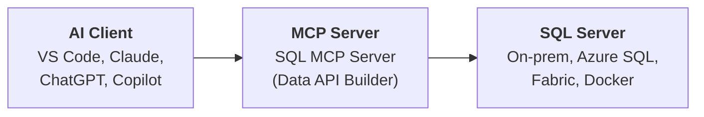

# Design and develop database solutions

_Build a strong relational foundation_

**Focus**: Database objects, programmability, advanced T-SQL, AI-assisted tools

**Topics to cover:**

- DP-800 Exam overview
- Design & Implement Database Objects(_Tables, indexes, constraints_)
- Implement Programmability Objects(_Views, Stored Procedures, Functions(scalar functions & table-valued functions), Triggers for maintainability and security_)
- Write Advanced T-SQL Code
- AI-Assisted Database Development

---

## Exam Overview

| Domain                                              | Weight | Focus                                                                |
| --------------------------------------------------- | ------ | -------------------------------------------------------------------- |
| **Design and develop database solutions**           | 35–40% | Database objects, programmability, advanced T-SQL, AI-assisted tools |
| **Secure, optimize, and deploy database solutions** | 35–40% | Security, performance, CI/CD, Azure integration                      |
| **Implement AI capabilities in database solutions** | 25–30% | Models/embeddings, intelligent search, RAG                           |

**Passing Score:** 700/1000  
**Format:** Multiple choice, case studies, drag-and-drop, hot area questions

---

### Core Platforms

- **SQL Server**: On-premises, IaaS, PaaS (Azure SQL Database, Managed Instance)
- **Azure SQL Database**: PaaS, serverless, hyperscale
- **SQL Databases in Microsoft Fabric**: (Lakehouse, Warehouse, Data Mart)

### Key Skills

- T-SQL development
- Designing relational and semi-structured data models
- CI/CD with GitHub
- Al fundamentals: embeddings, vectors, models
- Al-assisted development tools

```text
! Tip: Read `grokking Relational Database Design by Qiang Hao, Michail Tsikerdekis`
```

### Role

- Build secure, scalable database solutions
- Integrate Al into database-driven applications
- Optimize, deploy, and govern SQL workloads
- Work with App developers, DBAs, architects, Al and DevSecOps engineers, Security and compliance teams

```text
! Tip: SQL Projects, CI/CD, and Azure integration are key skills for this role.
```

## Module 1: Design and Implement Database Objects

Tables, indexes, constraints, JSON columns, partitioning, and specialized table types across SQL Server, Azure SQL, and Microsoft Fabric.

### Platform Choices

#### SQL Server-Based Platforms

&rarr; **SQL Server On-Prem** Full control, Windows/Linux, self-managed

&rarr; **Docker / Kubernetes** Containers, dev/test parity, quick spin-up

&rarr; **Azure SQL DB / MI** Managed PaaS, built-in HA, serverless tiers

&rarr; **Fabric SQL Database** Unified analytics, OneLake, Al-ready Copilot

### Table Design

#### Data Type Best Practices

- Choose appropriate data types and sizes to optimize storage and performance
- Normalize to third normal form and denormalize selectively for read-heavy workloads
- Every table needs a primary key that is narrow and immutable

### Specialized Table Types

- **In-Memory OLTP** RAM-resident, lock-free MVCC, up to 30x faster OLTP. Natively compiled SPs.

- **Temporal** System-versioned history tracking. FOR SYSTEM_TIME AS OF queries.

- **External** Query remote data via PolyBase - Blob, ADLS, S3, Oracle. No data movement.

- **Ledger** Tamper-evident, cryptographic verification. Updatable or append-only.

- **Graph** NODE + EDGE tables with MATCH clause. Social, fraud, recommendation use cases.

```text
! Tip: Match the table type to your workload - temporal for audit, ledger for compliance, graph for relationships, in-memory for high-throughput.
```

### Optimize with Indexes

**Clustered** Defines the physical sort order of table data
&rarr; 1 per table

**Non-clustered** Separate lookup structure for fast data retrieval
&rarr; Up to 999 per table

**Columnstore** Column-based storage for analytics and data warehouse workloads
&rarr; Analytics workloads, large fact tables

**Filtered** Indexes a subset of rows for targeted query optimization
&rarr; Subset of rows, improves performance for selective queries

**Full-Text** Enables natural language search across text content
&rarr; Linguistic search, stemming, thesaurus, ranking

**JSON Index** Native indexing for JSON document paths in SQL Server 2025
&rarr; Optimizes queries on JSON data stored in NVARCHAR columns

#### **Vector Index**

A vector index is a specialized index designed to optimize similarity searches on vector data, commonly used in applications like machine learning, recommendation systems, and Al. It enables efficient nearest neighbor searches by organizing vectors based on their relative distances

_SQL 2025 introduces native support for vector data types and indexing, allowing developers to store and query high-dimensional vectors directly within the database. This is particularly useful for applications that rely on embeddings, such as natural language processing or image recognition._

```text
! Tip: Index columns used in WHERE, JOIN, and ORDER BY clauses for best performance
```

### Constraints & JSON Support

#### Enforce Data Integrity

`PRIMARY KEY` Unique row ID, clustered index default, no NULLS

`FOREIGN KEY` Referential integrity, CASCADE/SET NULL/NO ACTION

`UNIQUE` Distinct values, allows one NULL, creates NC index

`CHECK` Boolean validation: salary >= 15000 AND salary <= 100000

`DEFAULT` Auto-assign on INSERT: GETDATE(), NEWID(), literals

#### JSON Columns & Indexes

- Native JSON data type in SQL Server 2025 - up to 2 GB per row
- `JSON_VALUE`, `JSON_QUERY`, `JSON_MODIFY`, `OPENJSON` for parse/transform
- `JSON_OBJECT`/`JSON_ARRAY` to construct `JSON` from `SQL`
- Computed column + standard index for specific `$.paths` (all versions)
- CREATE JSON INDEX: covers all paths without computed columns (2025+)
- Bridges relational + document models in a single platform
- `ISJSON()` validates JSON before storage; `OPENJSON()` shreds to rows

### Sequences and Partitioning

#### **SEQUENCE vs. IDENTITY**

| Feature          | SEQUENCE                             | IDENTITY                     |
| ---------------- | ------------------------------------ | ---------------------------- |
| **Scope**        | Database-level, shared across tables | Column-level, one table only |
| **Pre-generate** | NEXT VALUE FOR before INSERT         | Only on INSERT               |
| **Cycling**      | Configurable CYCLE / NO CYCLE        | Not supported                |
| **Cross-server** | Works on linked servers              | SET IDENTITY_INSERT issues   |

#### **Partitioning Strategy**

1 _Partition_ function defines how rows are mapped to partitions based on a column value.

&darr;

2 _Partition scheme_ maps the partition function to filegroups for storage.

&darr;

3 _Create partitioned table_ or index using the scheme.

&darr;

4 _Aligned indexes_ must match the partitioning column and scheme.

- Partition elimination - queries scan only relevant partitions
- Instant archival with ALTER TABLE SWITCH
- Rebuild indexes per partition - minimize downtime
- Sliding window for automated data lifecycle management

## Module 2: Implement Programmability Objects

Views, stored procedures, scalar functions, table-valued functions, and triggers for maintainable, secure, and efficient database solutions.

### Views

Virtual tables that simplify access, enforce security, and abstract schema changes.

#### **Standard Views**

- Encapsulate complex `JOIN`s into reusable queries
- Grant `SELECT` on view without exposing base tables
- `WITH CHECK OPTION` prevents inserts violating the view's `WHERE` clause

#### **Indexed Views(Materialized)**

&rarr; Precalculate the values and store them instead rather than calculating them everytime a query is run

- `WITH SCHEMABINDING` + unique clustered index
- Physically stores result set, Fast for aggregation-heavy reads
- Auto-maintained on DML; consider write overhead

#### **Partitioned Views**

- `UNION ALL` across member tables with `CHECK` constraints
- Distributed partitioned views span multiple servers
- Query optimizer routes to relevant member tables only

#### **Best Practices**

- Use `SCHEMABINDING` to prevent accidental base-table changes
- Avoid `SELECT *`
- Layer views for complex security rules
- Don't nest views beyond 2 levels for readability

### Stored Procedure

Server-side compiled programs that encapsulate business logic, reduce network round-trips, and enforce security.

#### **Core Capabilities**

- `INPUT` and `OUTPUT` parameters and `RETURN` value
- Temp tables and table variables for intermediate results
- Dynamic SQL with sp_executesql
- `TRY ... CATCH` + transactions for atomic operations
- `EXECUTE AS` for security context switching
- `SET NOCOUNT ON` to suppress row-count messages

#### **Design Patterns**

- `CRUD` operations
- ETL pipelines
- Report generation
- Natively compiled Stored Proceduress
- Often used as a security layer
- Plan caching: compiled once, reused but watch for parameter sniffing
- Use `OPTION (RECOMPILE)` or `OPTIMIZE FOR` when plans skew

### User-Defined Functions

#### **Scalar Functions**

_Return a single value (INT, VARCHAR, etc.)_

- Callable in `SELECT`, `WHERE`, `CHECK` constraints
- Can be deterministic
- Caution: performance
- Use `WITH SCHEMABINDING` for optimization

#### **Inline Table-Valued (iTVF)**

_Single SELECT returning a table &rarr; best performance_

- Inlined by optimizer like a parameterized view
- Supports `JOIN`, `WHERE`, aggregation in the body
- Preferred over multi-statement TVFs for read queries
- Can reference in `CROSS APPLY`/`OUTER APPLY`

#### **Multi-Statement TVF**

_Multiple statements, explicit RETURNS TABLE variable_

```text
Steps to create one:
1. Declare a table and inside the function,
2. Insert rows into that table
3. What you do at the end is you return that back.
```

- Populate and return @table
- Never inlined (and often cardinality issues)
- Use for complex logic that can't be a single query
- SQL Server 2019+ interleaved execution helps cardinality

### Triggers

Automatically respond to data modifications or database events - use sparingly for audit, validation, and enforcement.

#### **DML Triggers** &rarr; _`AFTER/INSTEAD OF`_

- Fire on `INSERT`, `UPDATE`, `DELETE`
- `AFTER`: runs after the DML statement completes
- `INSTEAD OF`: replaces the DML - enables updatable views
- Access inserted/deleted pseudo-tables for old/new values

#### **DDL Triggers** &rarr; _`Database/Server`_

- Respond to `CREATE`, `ALTER`, `DROP` events
- Database-scoped or server-scoped
- `EVENTDATA()` returns XML with event details
- Audit schema changes or rollback unauthorized DDL

#### **Logon Triggers** &rarr; _`Server-Level`_

- Fire on `LOGON` events after authentication
- Control session creation based on _`time/IP/count`_
- Limit concurrent sessions per login
- Use carefully - can lock out all users if broken

#### **Best Practices**

- Keep trigger logic minimal
- Avoid nested triggers . Never rely on trigger firing order
- Consider temporal tables as an alternative for audit
- Test with multi-row operations

## Module 3: Write Advanced T-SQL Code

CTEs, window functions, JSON processing, regular expressions, fuzzy matching, graph queries, and structured error handling.

### CTEs and Correlated Subqueries

#### **Common Table Expressions**

- `WITH` clause defines named, temporary result sets
- Scope: single `SELECT`, `INSERT`, `UPDATE`, or `DELETE` statement
- Recursive CTEs for hierarchical data: org charts, BOMs, tree traversal
- Anchor member + recursive member joined by `UNION ALL`
- `MAXRECURSION` hint controls depth (default 100, max 32767)
- Multiple CTEs in a single `WITH` - separate with commas
- Improves readability vs deeply nested subqueries
- Not persisted - recalculated each reference (use temp tables if needed twice)

#### **Correlated Subqueries**

- Inner query references columns from the outer query
- Executes once per outer row - watch for $O(n^2)$ performance
- `EXISTS`/`NOT EXISTS` for semi-join patterns
- Row-by-row comparisons: find max per group, running differences
- Can often be rewritten as `JOIN`s or window functions for speed
- Useful in UPDATE/DELETE with correlated conditions
- Derived tables: subquery in `FROM` clause with an alias
- `CROSS APPLY`/`OUTER APPLY` for table-valued expressions

### Window Functions

Perform calculations across rows related to the current row, without collapsing result sets like `GROUP BY`.

#### **Ranking**

`ROW_NUMBER`
`RANK`
`DENSE_RANK`
`NTILE`

Assign positions within partitions.

`ROW_NUMBER` is always unique; `RANK` allows ties.

#### **Offset**

`LAG`/`LEAD`

`FIRST_VALUE`

`LAST_VALUE`

Access previous/next rows or partition boundaries without self-joins.

#### **Aggregate**

`SUM`/`AVG`

`COUNT`

`MIN`/`MAX`

Running totals, moving averages over `ROWS BETWEEN` or `RANGE` frames.

#### **Distribution**

`PERCENT_RANK`

`CUME_DIST`

`PERCENTILE_CONT`

`PERCENTILE_DISC`

Statistical distribution and percentile calculations within groups.

**_Syntax_**:

```sql
function() OVER ( PARTITION BY col ORDER BY col ROWS BETWEEN UNBOUNDED PRECEDING AND CURRENT ROW )
```

### JSON & XML Processing in T-SQL

#### **JSON Functions**

- `FOR JSON PATH`/`AUTO` - convert result sets to _JSON_
- `OPENJSON` - shred JSON arrays/objects into rows with schema
- `JSON_VALUE` - extract scalar from `$.path` expression
- `JSON_QUERY` - extract object or array sub-document
- `JSON_MODIFY` - update values in-place without full rewrite
- `JSON_OBJECT`/`JSON_ARRAY` - construct _JSON_ (SQL 2022+)
- `ISJSON` - validate _JSON_ before storage or processing
- `JSON_CONTAINS` - check if value exists (SQL 2025)

#### **XML Functions**

- `FOR XML PATH`/`RAW`/`AUTO` - convert to XML output
- `.query()` - XQuery expressions on XML columns
- `.value()` - extract scalar from XPath expression
- `.modify()` - insert, delete, or replace XML nodes
- `.nodes()` - shred XML into relational rows
- `OPENXML` + `sp_xml_preparedocument` for legacy parsing
- XML indexes: primary + secondary (PATH, VALUE, PROPERTY)
- XML Schema Collections for strong typing and validation

### Regex & Fuzzy Matching

#### **Regular Expressions**

- `REGEXP_LIKE` - filter rows matching a pattern (replaces complex `LIKE` chains)
- `REGEXP_REPLACE` - pattern-based string replacement with capture groups
- `REGEXP_SUBSTR` - extract substrings matching a pattern
- `REGEXP_INSTR` - returns the starting position of a pattern match within a string. Returns 0 if no match is found
- `REGEXP_COUNT` - count occurrences of a pattern in text
- `REGEXP_MATCHES` - is a table-valued function that returns all pattern matches as separate rows
- `REGEXP_SPLIT_TO_TABLE` - is a table-valued function that splits a string into rows based on a delimiter pattern
- `SARGable`: can use indexes for efficient execution
- ICU regex engine - full Unicode support, `POSIX` classes
- Use cases: email validation, phone parsing, data cleansing, log analysis

#### **Fuzzy String Matching**

- `EDIT_DISTANCE` - Levenshtein distance between two strings
- `EDIT_DISTANCE_SIMILARITY` - percentage similarity (0-100)
- `SOUNDEX` - phonetic encoding for English names
- `DIFFERENCE` - compare `SOUNDEX` codes (0-4 scale, 4 = exact)
- Combine with thresholds: `WHERE EDIT_DISTANCE_SIMILARITY > 80`
- Use cases: deduplication, address matching, customer name resolution
- Pair with regex: clean first (regex) > match (fuzzy) -> deduplicate

### Graph Queries & Error Handling

#### **Graph Queries (MATCH)**

- `NODE` tables store entities; `EDGE` tables store relationships
- `MATCH` clause: `WHERE MATCH(Person-(Follows)->Person)`
- `SHORTEST_PATH` for finding shortest route between nodes
- Variable-length traversal with + quantifier
- `CONNECTION` constraint restricts which nodes an edge can connect
- Combine graph + relational queries in single T-SQL statements
- Use cases: social networks, fraud rings, org hierarchies, recommendations

#### **TRY ... CATCH Error Handling**

- `TRY` block wraps statements; `CATCH` block handles errors
- `ERROR_NUMBER()`, `ERROR_MESSAGE()`, `ERROR_SEVERITY()`, `ERROR_LINE()`
- `THROW` - re-raise or raise custom errors (replaces RAISERROR)
- `XACT_ABORT ON`: auto-rollback on any error - simplifies cleanup
- Nest `TRY ... CATCH` with transactions for atomic multi-step operations
- `@@TRANCOUNT` checks active transaction depth before `COMMIT/ROLLBACK`
- Log errors to a table in `CATCH` before re-throwing

## Module 4: Al-Assisted Database Development

Accelerate SQL authoring with GitHub Copilot, Fabric Copilot, and Model Context Protocol (MCP) for agent-driven database operations.

### GitHub Copilot for SQL

Al-powered assistant inside SSMS 22 and VS Code - schema-aware, version-specific T-SQL generation.

**Natural Language to SQL** &rarr; Describe what you need in plain English. Copilot generates schema-aware T-SQL with correct table/column references and JOINs.

**Code Completions** &rarr; Real-time "ghost text" suggestions as you type. Tab to accept, keep typing to ignore. Reduces syntax errors and boilerplate.

**Explain & Optimize** &rarr; Select any query and ask Copilot to explain
what it does or suggest optimizations. Great for debugging legacy code.

**Schema Awareness** &rarr; Reads your active database connection - knows SQL version, tables, columns, keys, and relationships for contextual suggestions.

```text
! Note
-> Requires SSMS 22+ or VS Code MSSQL extension.
-> GitHub Copilot subscription (Free tier: 50 requests).
-> Respects DB permissions
```

### Fabric Copilot for SQL

Al assistant in the Fabric SQL database workload - natural language queries, code completion, and quick actions.

**Chat Pane** Ask natural language questions about your database. Get T-SQL queries or documentation answers directly in the Fabric portal.

**Code Completion** Start typing in the SQL query editor - Copilot suggests completions for table names, functions, and full queries. Tab to accept.

**Quick Actions: Fix** Highlight a failing query and click Fix. Copilot identifies errors, corrects syntax, and adds comments explaining changes.

**Quick Actions: Explain** Select any SQL block and click Explain. Copilot provides natural language explanation of query logic and schema usage.

```text
Built on same AI tools as SSMS Copilot

Consistent experience across Fabric portal, SSMS 22, and VS Code
```

### Model Context Protocol (MCP)

Open protocol standardizing how AI agents safely interact with databases - a "USB-C port" for AI applications.



### Al Workflow Integration

Combining tools: Copilot for authoring, MCP for live data access, Fabric for unified analytics.

**Author** Use GitHub Copilot in SSMS/VS Code to write and optimize T-SQL. Schema-aware suggestions accelerate development.

**Connect** SQL MCP Server bridges AI agents to your database. Agents discover schemas and run queries through standard protocol.

**Analyze** Fabric Copilot enables natural language exploration in the portal. Quick actions fix errors and explain complex logic.

**Govern** Copilot instruction files (.github/copilot-instructions.md)
enforce coding standards. RBAC in MCP controls data access.

```text
! Note
Best practice:
-> Always review Al-generated SQL before production
-> Use EXPLAIN to validate query plans
-> Start with read-only access for AI agents
```

### When to Use What - Decision Guide

_High-throughput OLTP with latch contention_ &rarr; `In-memory` OLTP tables + natively compiled SPs

_Audit trail / data forensics / compliance_ &rarr; Ledger tables (updatable or append-only)

_Query external storage without import_ &rarr; External tables with PolyBase / REST APIs

_Complex relationships (social, fraud)_ &rarr; Graph tables + MATCH + SHORTEST_PATH

_Reusable read-only access layers_ &rarr; Views (standard or indexed for aggregation)

_Complex pattern matching/text parsing_ &rarr; Regex functions (SQL 2025) + full-text index

_AI-powered query authoring_ &rarr; GitHub Copilot in SSMS 22 / VS Code

_AI agent database operations_ &rarr; SQL MCP Server + Data API Builder + RBAC
