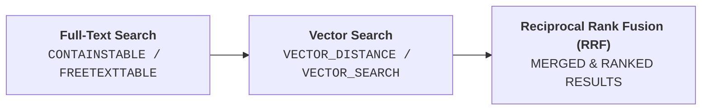
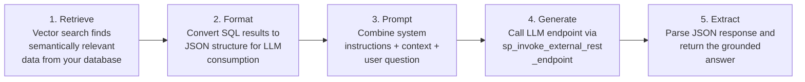

# Implement AI Capabilities in database solutions

Modules in this section:

- Intelligent search
- Embeddings & vector data
- Retrieval-Augmented Generation (RAG)

## Module 1: Design & Implement Models & Embeddings with SQL

### Key Takeaways for this module in terms of exam preparation

`CREATE EXTERNAL MODEL` connects SQL to Azure OpenAI - use Managed Identity for secure, passwordless access

Only embed columns with semantic meaning - not IDs, numbers, or status codes

Chunking strategy depends on content type - smaller chunks give precision, larger chunks preserve context

`AI_GENERATE_EMBEDDINGS` + `VECTOR(n)` data type are the core embedding
functions in T-SQL

Choose a maintenance pattern based on your staleness tolerance vs write
performance needs

---

## Module 2: Design & Implement Intelligent Search with SQL

| Feature              | Full-Text Search           | Vector Search            | Hybrid Search             |
| -------------------- | -------------------------- | ------------------------ | ------------------------- |
| **Matches on**       | Exact words & stems        | Semantic meaning         | Both keywords AND meaning |
| **Finds synonyms?**  | Only with thesaurus        | Yes — automatically      | Yes                       |
| **Handles typos?**   | No (exact match)           | Somewhat (similarity)    | Better than either alone  |
| **Speed**            | Very fast (inverted index) | Fast (vector index, ANN) | Moderate (two indexes)    |
| **Setup complexity** | Low                        | Medium                   | High (both + fusion)      |
| **Best for**         | Exact keyword search       | Natural language queries | Production systems        |

**Decision Guide:** Product SKU / exact name $\rightarrow$ Full-text | Natural language description $\rightarrow$ Vector | E-commerce millions of products $\rightarrow$ Hybrid | Error code log analysis $\rightarrow$ Full-text | Similar support tickets $\rightarrow$ Vector | Legal document discovery $\rightarrow$ Hybrid

### **Implement Full-Text Search**

#### **Setup Requirements**

1. Create a full-text catalog to organize indexes
2. Create a full-text index on the target columns
3. Specify a unique key column (usually primary key)
4. Choose a language for linguistic processing

#### **Query Functions**

**CONTAINS**
Exact word or phrase matching; supports AND, OR, NEAR operators

**FREETEXT**
Finds meaning matches using stemming, thesaurus, and inflectional forms

**CONTAINSTABLE**
Returns ranked results with relevance scores as a table

**FREETEXTTABLE**
Returns ranked meaning-based results as a table

```text
! Tip: CONTAINS = exact word matching | FREETEXT = meaning matching. Know when to use each, plus their TABLE variants for ranked results.
```

### **Vector Data Types & Index Strategies**

#### **Vector Data Type**

&rarr; Native VECTOR(n) type - n is the dimension count

&rarr; Common sizes: 768, 1536 dimensions

&rarr;Dimension must match the embedding model output

&rarr; Stored as binary for efficient comparison

**1. KNN (Exact Nearest Neighbor)**
&rarr; Brute-force comparison against all vectors

&rarr; 100% recall - always finds the true nearest neighbors

&rarr; Best for: small datasets, accuracy-critical scenarios

_No index needed - scans all rows_

**2. ANN (Approximate Nearest Neighbor)**
&rarr; Index-based search using DiskANN algorithm

&rarr; Trades small accuracy for massive speed

&rarr; Best for: large datasets, production search at scale

_Requires vector index - uses DiskANN graph_

**HSNW (Hierarchical Navigable Small World)**
&rarr; Graph-based index for ANN search

&rarr; Efficient for high-dimensional data

&rarr; Best for: large-scale vector search with low latency

_Requires vector index - uses HNSW graph_

```text
! Tip: Use KNN for small datasets or when accuracy is critical. Use ANN or HNSW for large datasets where speed is essential.
```

#### **Distance Metrics**

**Cosine**: Direction similarity (ignores magnitude)

**Euclidean**: Absolute distance between points

**Dot Product**: Combined direction + magnitude

### **Implementing Vector Search**

#### **VECTOR_DISTANCE**

```sql
SELECT TOP 10 Title, VECTOR_DISTANCE('cosine', Embedding, @qVec) AS dist
FROM Documents
ORDER BY dist;

-- Add WITH APPROXIMATE for ANN
```

#### **VECTOR_SEARCH**

```sql
SELECT * FROM
    VECTOR_SEARCH(
        TABLE = Documents,
        COLUMN = Embedding,
        QUERY_VECTOR = @qVec,
        TOP_N = 10);
```

#### **Key Distinctions**

- `VECTOR_DISTANCE` returns a numeric distance value
- `VECTOR_SEARCH` returns a table of nearest results
- `WITH APPROXIMATE` triggers ANN (requires index)
- `Without APPROXIMATE`, search uses KNN (exact search)

### **Hybrid Search & Reciprocal Rank Fusion**



#### **How RRF Works**

RRF normalizes and merges ranked results from multiple search methods without requiring comparable scores.

$$RRF\_Score = \sum 1 / (k + rank_i) for each search method$$

- No need to normalize different score scales
- Penalizes items ranked low in any single method
- Rewards items consistently ranked high across methods
- k parameter (usually 60) controls rank sensitivity

### **Evaluating Search Performance**

**Recall**
What percentage of relevant documents were found? KNN = 100% recall. ANN trades small recall loss for speed.

**Latency**

How fast are results returned? ANN with DiskANN index is orders of magnitude faster than KNN at scale.

**Precision**

Of the results returned, how many were actually relevant? Hybrid search typically improves precision.

**Index Overhead**

Vector indexes consume memory and storage. Balance recall requirements against resource costs.

```text
! Tip: Know the trade-offs - ANN is faster but ~95% recall; KNN is slower but 100% recall. Hybrid + RRF gives the best relevance.
```

### Key Takeaways from this module in terms of exam preparation

- [x] Full-text search excels at exact keywords; vector search handles semantic meaning; hybrid combines both

- [x] VECTOR_DISTANCE returns a scalar; VECTOR_SEARCH returns a table - know when to use each

- [x] KNN = 100% recall, brute force; ANN = ~95% recall, uses DiskANN index for speed at scale

- [x] WITH APPROXIMATE is the T-SQL keyword that switches from ENN to ANN

- [x] Reciprocal Rank Fusion (RRF) merges rankings without normalizing scores - essential for hybrid search

- [x] Cosine distance is the most common metric for text embeddings; know all three metrics

---

## Module 3: Design & Implement RAG with SQL

### ** When to Use RAG**

#### **Use RAG when:**

- [x] **Customer support chatbot**: Answers grounded in YOUR knowledge base

- [x] **Internal FAQ system**: Responses cite specific company documents

- [x] **Product recommendation**: Explains WHY based on actual product data

- [x] **Report summarization**: Summarizes YOUR data, not imaginary data

- [x] **Code review assistant**: Reviews against YOUR coding standards

```text
!TIP: "Data changes often" > RAG, not fine-tuning. RAG uses current data at query time. Fine-tuning bakes stale data into the model.
```

#### **Don't Use RAG When:**

&#10008; Simple lookups: "Customer 42's email?" - just use SELECT

&#10008; Aggregations: "Total sales this month" - use SUM, not RAG

&#10008; Real-time decisions: Millisecond-critical paths - RAG adds latency

&#10008; No relevant data: If your DB doesn't have the answer, RAG can't help

### **The RAG Pipeline in T-SQL**



#### **Why RAG in SQL?**

**Grounded Answers** LLM responses based on your actual data - reduced hallucinations

**No Data Migration** Al works directly with data in SQL - no ETL to external systems

**Security Preserved** Existing RLS, permissions, encryption apply to Al-retrieved context.

### **Step 1: Retrieve Relevant Context**

```sql
-- Embed user question
DECLARE @qVec VECTOR(1536);
SET @qVec = AI_GENERATE_EMBEDDINGS
    (@question USE MODEL EmbedModel);

-- Vector search for relevant docs
SELECT TOP 5 Title, Content,
  VECTOR_DISTANCE('cosine', Embedding, @qVec) AS dist
INTO #Context
FROM KnowledgeBase
```

**What's Happening**

1. User question is converted to a vector embedding
2. VECTOR_DISTANCE finds the 5 most similar documents
3. Results stored in temp table for next step

```text
Retrieval Quality Matters: The LLM can only work with the context you provide. If retrieval returns irrelevant documents, the generated answer will be poor - even with a perfect prompt. Use hybrid search + RRF for best retrieval quality in production RAG systems.
```

### **Steps 2 & 3: Format Context & Build Prompt**

**Step 2: Convert to JSON**

```sql
DECLARE @ctx NVARCHAR(MAX);
SELECT @ctx = JSON_ARRAYAGG(
    JSON_OBJECT('title': Title, 'content': Content))
FROM #Context;
```

**Step 3: Construct the Prompt**

```sql
JSON_OBJECT(
    'messages': JSON_ARRAY(
        JSON_OBJECT('role':'system', 'content': @sysMsg),
        JSON_OBJECT('role':'user','content': @question)
        )
    )
```

#### **Prompt Structure**

**System Message**: Instructions + guardrails:

    "Answer ONLY based on the provided context. If the context doesn't contain the answer, say so."

**Context Injection**

    The JSON-formatted search results from Step 2 - this is what grounds the LLM response

**User Message**

    The original user question - the LLM combines this with the context to generate a grounded answer

### **Steps 4 & 5: Call LLM & Extract Response**

#### **Step 4: Call the Model**

```sql
DECLARE @response NVARCHAR(MAX);
EXEC sp_invoke_external_rest_endpoint
    @url = 'https://myoai ... completions'
    ,@method = 'POST'
    ,@payload = @requestBody
    ,@response = @response OUTPUT;
```

#### **Step 5: Extract the Answer**

```sql
-- Extract answer from JSON response
SELECT JSON_VALUE(
    @response,
    '$.result.choices[0].message.content')
AS Answer;
```

**Key Concepts**

`sp_invoke_external_rest_endpoint`
The T-SQL stored procedure that calls external REST APIs - this is how SQL talks to Azure OpenAI

`JSON_VALUE for extraction`
Navigate the nested JSON response to extract the generated text from the LLM

`Error handling`
Always wrap in `TRY ... CATCH` - external API calls can fail due to rate limits, timeouts, or service issues

### Key Takeaways from this module in terms of exam preparation

- [x]RAG = Retrieve relevant data + Augment prompt with context + Generate grounded response

- [x] Use RAG when data changes often; use fine-tuning only when data is static and domain-specific

- [x] `sp_invoke_external_rest_endpoint` is the bridge between T-SQL and external LLM APIs

- [x] `JSON` functions (JSON_OBJECT, JSON_ARRAY, JSON_ARRAYAGG, JSON_VALUE) are essential for RAG

- [x] Always instruct the LLM to only answer based on provided context - this prevents hallucinations

- [x] Retrieval quality drives RAG quality - invest in hybrid search + RRF for production systems

### The Complete Picture

#### **Models & Embeddings**

&rarr; CREATE EXTERNAL MODEL

&rarr; Chunking strategies

&rarr; AI_GENERATE_EMBEDDINGS

&rarr; VECTOR(n) data type

&rarr; Maintenance patterns

#### **Intelligent Search**

&rarr; Full-text: CONTAINS / FREETEXT

&rarr; Vector: VECTOR_DISTANCE

&rarr; ANN vs KNN (DiskANN index)

&rarr; Hybrid search

&rarr; Reciprocal Rank Fusion

#### **RAG with SQL**

&rarr; Retrieve Format &rarr; Prompt

&rarr; JSON shaping functions

&rarr; `sp_invoke_external_rest_endpoint`

&rarr; System + user messages

&rarr; Response extraction
